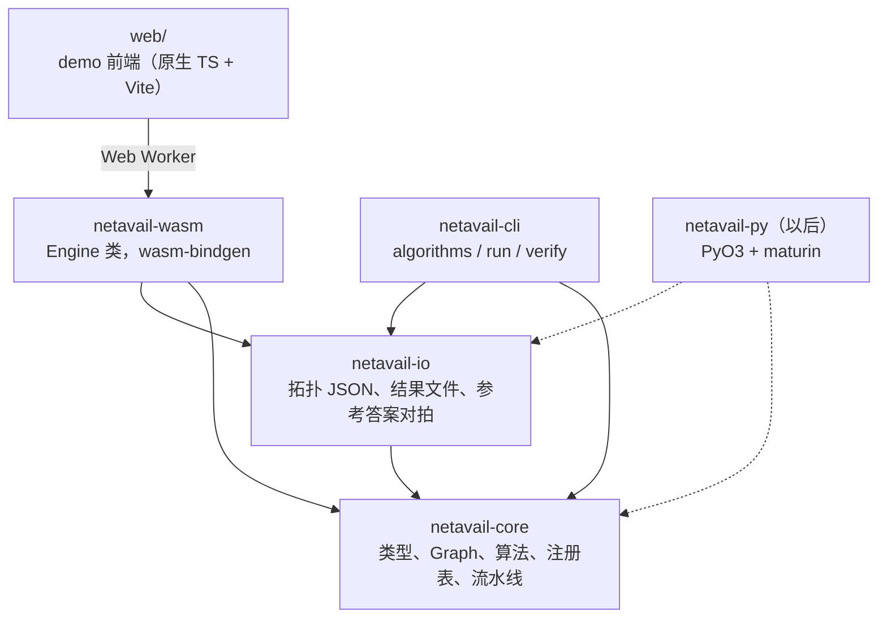
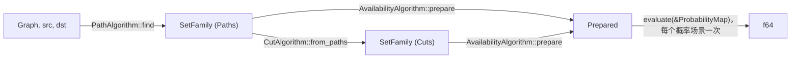
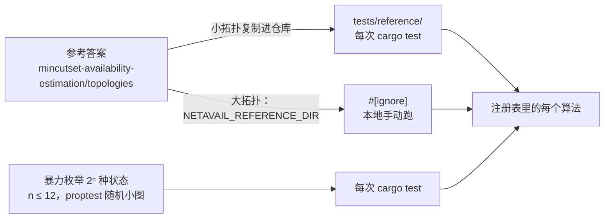

# netavail 架构

状态：已确认（2026-11-16）。每条决定的理由见 [decisions.md](decisions.md)，下文用 (Dn) 标出出处。

## 1. 目标与约束

- 目标：用 Rust 重写 PyRBD-Suite 的计算核心，先做浏览器版 app（D15），以后再做 Python 包和桌面版。
- 算法整体思路不变。为了得到一致的结果，允许做必要的小改动，比如显式规定排序顺序（D2）。
- 结果一致的定义（D3）：
  - 路集、割集：每个集合内部排序，集合列表再按（长度、字典序）排序，之后完全相等。
  - 可用度：和参考答案 CSV 比较时，绝对误差 ≤ 1e-9（CSV 只保留 9 位小数）；和暴力枚举比较时，绝对误差 ≤ 1e-12。
  - 中间表示（布尔表达式、SDP 项的顺序）不要求逐字一致。
- 性能预期与 C++ 持平。耗时主要由算法决定，换语言改变不了（D1）。
- 不考虑论文复现（D11）。

## 2. 总体结构

一个 Cargo workspace：一个仓库里放多个 crate（Rust 的包），共用依赖版本，`cargo build` / `cargo test` 一次处理全部 crate（D21）。



依赖只能向下。core 不依赖任何其它 crate，不做文件 IO，不计时（`std::time::Instant` 在 wasm 下会 panic），也不开线程（D15）。

```
netavail/
├── Cargo.toml                 # workspace 定义 + 统一依赖版本
├── rust-toolchain.toml        # 固定 Rust 版本
├── crates/
│   ├── netavail-core/
│   │   ├── src/               # 见第 3 节
│   │   └── benches/           # criterion 性能测试
│   ├── netavail-io/
│   │   ├── src/               # topology、results、reference
│   │   └── tests/reference.rs # 参考答案对拍
│   ├── netavail-wasm/
│   └── netavail-cli/
├── web/                       # demo 前端，见第 5 节
├── tests/reference/<Topo>/    # 小拓扑的参考答案（随仓库提交）
├── tools/                     # 一次性 Python 脚本（核对 pickle 与 JSON 编号等）
└── docs/
```

`netavail-py`、`apps/desktop` 等到要用时再建。

## 3. netavail-core

```
crates/netavail-core/src/
├── lib.rs
├── types.rs          NodeId、Lit、NodeSet、Term、SetKind、SetFamily
├── prob.rs           ProbabilityMap
├── graph.rs          Graph、fingerprint()
├── transform.rs      to_link_graph（阶段 4）
├── registry.rs       AlgoInfo、Citation、注册表
├── pipeline.rs       Plan、run_pair、run_all
├── control.rs        Control trait
├── error.rs
├── sets/
│   ├── absorb.rs
│   ├── minimalpaths/ mod.rs（trait PathAlgorithm）、dfs.rs
│   └── minimalcuts/  mod.rs（trait CutAlgorithm）、decision_tree.rs、shannon.rs、
│                     path_product.rs、combination.rs、combination_bits.rs
└── availability/     mod.rs（trait AvailabilityAlgorithm、Prepared）、
                      cut_disjoint.rs、path_disjoint.rs、path_sdp.rs
```

### 3.1 基本类型（D7、D8、D22）

| 类型 | 定义 | 说明 |
|---|---|---|
| `NodeId` | `u32` | 从 0 开始，内外统一，不再有 +1 偏移 |
| `Lit` | `struct Lit(u32)`，值为 `node << 1 \| is_down` | 带状态的节点。节点 0 也能表示"不可用" |
| `NodeSet` | `Vec<NodeId>` | 一条路径或一个割集，不带符号 |
| `Term` | `Vec<Lit>` | 可用度计算的乘积项，带符号 |
| `SetFamily` | `{ kind: Paths \| Cuts, src, dst, sets: Vec<NodeSet> }` | 一个节点对的全部路集或割集 |
| `ProbabilityMap` | `Vec<f64>`，按 Lit 内部值交错存放 `p₀, 1-p₀, p₁, 1-p₁, …` | 查询就是 `probs[lit.0]`，不需要分支 |

- `Lit` 有两种"顺序"，互不干扰：作数组下标时用内部值；排序时手写 `Ord`，排序键为 `is_down ? -(node+1) : (node+1)`，复刻 C++ 的有符号整数顺序（SDP 依赖这个顺序）。
- 集合内部保持算法原样输出的顺序，`normalize()` 只在比较时使用。
- `ProbabilityMap::uniform(n, p)` 让所有节点取同一个 p；`ProbabilityMap::from_nodes(...)` 使用每个节点各自的概率。

### 3.2 Graph（D23、D28）

```rust
pub struct Graph { adj: Vec<Vec<NodeId>> }

impl Graph {
    pub fn from_edges(n: u32, edges: &[(NodeId, NodeId)]) -> Result<Graph, Error>;
    pub fn node_count(&self) -> u32;
    pub fn neighbors(&self, u: NodeId) -> &[NodeId];
    pub fn fingerprint(&self) -> Fingerprint;
}
```

- 无向简单图。邻居顺序等于边的输入顺序。遇到自环、重复边、节点号越界时报错。
- 指纹 = BLAKE3(`"netavail-graph-v1"` + n + m + 排序后的 (min, max) 边列表，整数都用 u32 小端序)。指纹只取决于图的结构，边的顺序和方向、概率、坐标、名字都不影响它。

### 3.3 算法接口和注册表（D26、D27）



```rust
pub struct AlgoInfo {
    pub id: &'static str,           // 代码、命令行、网页都用它
    pub name: &'static str,         // 界面上的短名，≤ 18 字符
    pub summary: &'static str,      // 一句话说明算法过程
    pub version: u32,               // 修 bug 后加 1，让旧缓存失效
    pub aliases: &'static [&'static str], // 旧名
    pub citation: Citation,
}

pub trait PathAlgorithm: Sync {
    fn info(&self) -> &'static AlgoInfo;
    fn find(&self, g: &Graph, src: NodeId, dst: NodeId, ctl: &dyn Control)
        -> Result<SetFamily, Error>;
}

pub trait CutAlgorithm: Sync {
    fn info(&self) -> &'static AlgoInfo;
    fn from_paths(&self, paths: &SetFamily, ctl: &dyn Control) -> Result<SetFamily, Error>;
}

pub trait AvailabilityAlgorithm: Sync {
    fn info(&self) -> &'static AlgoInfo;
    fn input(&self) -> SetKind;
    fn prepare(&self, sets: &SetFamily, ctl: &dyn Control) -> Result<Box<dyn Prepared>, Error>;
}

pub trait Prepared: Send + Sync {
    fn evaluate(&self, p: &ProbabilityMap) -> f64;
}
```

- 割集算法以路集为输入：现有 5 个割集算法开头都先求路集。
- `prepare` 比较慢，和概率无关，只做一次；`evaluate` 很快，可以对多组概率重复调用。
- `registry.rs` 列出全部算法，网页下拉框、CLI 的 `--paths/--cuts/--avail` 参数、一致性测试都从这里读取。**加一个新算法 = 新建一个文件实现 trait + 在注册表里加一行**，加完它会自动出现在界面上，也会自动被参考答案测试覆盖。
- 首批不设计算法参数，也不做布尔表达式和 debug 输出。

| 类别 | id | name | summary | 旧名 |
|---|---|---|---|---|
| 路集 | `dfs` | DFS | Enumerate chordless paths by depth-first search | `minimalpaths` |
| 割集 | `decision_tree` | Decision tree | Branch on the most frequent node, multiply leaves (Fast-MCS) | `cnf_tree` |
| 割集 | `shannon` | Shannon expansion | Recursively split on a pivot node, then combine | `shannon` |
| 割集 | `path_product` | Path product | Multiply all path sets pairwise with absorption | `multiplication` |
| 割集 | `combination` | Combination | Test node combinations of increasing size against all paths | `combination` |
| 割集 | `combination_bits` | Combination (bits) | Same as Combination, using bitwise OR on the incidence matrix | `combination_matrix` |
| 可用度 | `cut_disjoint` | Cut disjoint | Make minimal cut sets disjoint, sum unavailability | `mcs` |
| 可用度 | `path_disjoint` | Path disjoint | Make minimal path sets disjoint, sum availability | `pathset` |
| 可用度 | `path_sdp` | SDP | Sum of disjoint products with decomposition (PyRBD3) | `sdp` |

### 3.4 流水线（D29）

```rust
pub struct Plan { /* private: paths, cuts, availability */ }
impl Plan {
    pub fn new(paths: &'static dyn PathAlgorithm,
               cuts: Option<&'static dyn CutAlgorithm>,
               availability: Option<&'static dyn AvailabilityAlgorithm>) -> Result<Plan, Error>;
}

pub fn run_pair(plan: &Plan, g: &Graph, src: NodeId, dst: NodeId,
                scenarios: &[ProbabilityMap], ctl: &dyn Control) -> PairResult;

// Same, reusing and filling a cache that belongs to g (D37)
pub fn run_pair_cached(plan: &Plan, g: &Graph, src: NodeId, dst: NodeId,
                       scenarios: &[ProbabilityMap], ctl: &dyn Control,
                       cache: &mut Cache) -> PairResult;

pub fn run_all(plan: &Plan, g: &Graph, pairs: &[(NodeId, NodeId)],
               scenarios: &[ProbabilityMap], ctl: &dyn Control) -> Vec<PairResult>;
```

- `Plan::new` 检查搭配是否合法，例如可用度算法要割集，就必须选了割集算法。
- 默认计算所有满足 i < j 的无序节点对，顺序为 (0,1), (0,2), …，与参考答案一致。
- `PairResult` 包含 src、dst、路集数、割集数、每个场景的可用度、错误（如果有）。某一对出错不影响其它对。集合本身不放进结果，按需从缓存取。
- `run_all` 在 feature `parallel` 打开时用 rayon（work stealing，自动做动态分配），关闭时串行。算法内部的并行做成单独的算法，只在 feature `parallel` 打开时注册，所以只有 CLI 能用，浏览器没有。目前只有一个：`path_sdp_parallel`，移植自 C++ `toSDPSetParallel`。它把每条路径的乘积分到各个线程上算，再按路径顺序合并，结果和 `path_sdp` 逐位相同；路径少于 200 条时直接走串行版。

### 3.5 Control（D29）

```rust
pub trait Control: Sync {
    fn check(&self) -> Result<(), Cancelled> { Ok(()) }                    // 取消
    fn on_stage(&self, src: NodeId, dst: NodeId, stage: Stage, event: StageEvent) {} // 计时
    fn max_sets(&self) -> Option<usize> { None }                           // 集合数上限
    fn max_terms(&self) -> Option<usize> { None }                          // 不相交项上限（D37）
}
```

由适配层实现：CLI 用 Ctrl-C 设置一个原子标志，用 `Instant` 计时；浏览器用 `performance.now()` 计时，并默认设置集合个数上限。Worker 在算一对时收不到消息，所以浏览器里的取消由 Worker 池负责：不再分配新的节点对，1 秒后还在算的 Worker 才 terminate（D39）。

### 3.6 缓存 key（D28、D30）

```
路集 key    = (图指纹, src, dst, 路集算法 id, version)
割集 key    = (路集 key, 割集算法 id, version)
prepare key = (集合 key, 可用度算法 id, version)
evaluate    不缓存
```

core 只负责算出 key，缓存存在哪里由适配层决定。

## 4. netavail-io（D24、D25）

拓扑文件沿用 PyRBD-Suite 前端的 JSON 格式（不是 node_link）：

```json
{
  "version": 1,
  "name": "Abilene",
  "nodes": [{"id": "0", "label": "0", "prob": 1.0, "x": -493.9, "y": 431.2}],
  "edges": [{"source": "0", "target": "1", "prob": 1.0}]
}
```

```
拓扑 JSON ──解析──► Topology (io)：name、nodes、edges，包括坐标、label、链路概率
                      ├─ .graph()         ──► Graph (core)
                      ├─ .scenario(nodes, links) ──► ProbabilityMap (core)
                      └─ .to_json()       ──► 拓扑 JSON（version 1，读回来和原来一致）
```

- 字符串 id 按出现顺序映射成 0…n-1。`version` 字段可选。
- `to_json()` 总是写出 `version: 1` 和每个节点的 label、prob；坐标只在有的时候写；边用原来的字符串 id。Engine 暂时没有导出方法，正式界面需要时再加。
- 场景（`Prob`）：一个数 p（所有节点或所有链路都取 p），或者 `file`（每个节点、每条边用文件里自己的 prob）。`scenario(nodes, links)` 先给出 n 个节点的概率；给了 `links` 时，后面再接每条边的概率，顺序和链路图里的节点编号一致。
- 模块：`topology`（拓扑读写）、`results`（结果 CSV、集合导出 + `meta.json`）、`reference`（解析旧参考答案 CSV，规范化后对拍）。
- 导出集合时附带图指纹，导入时比对。旧的参考答案 CSV 没有指纹，导入时改做合法性检查。
- 不使用数据库，只保存拓扑，不保存计算结果。

## 5. 浏览器（D15、D16、D17、D31、D32）

```
主线程 ─ web/src/main.ts（demo 页面）
   │      web/src/pool.ts（Worker 池：分配节点对、路由、取消）
   │ postMessage
Worker × N ─ web/src/worker.ts（转发消息）
   │
netavail-wasm::Engine ─► netavail-io ─► netavail-core
```

`Engine` 是对外的稳定接口，以后重做界面时，这一层不变：

| 方法 | 作用 |
|---|---|
| `new(topology)` | 解析并校验拓扑 |
| `load(topology)` | 换拓扑；图指纹没变就保留缓存 |
| `topology()` | 节点（含 label、坐标）、边、图指纹 |
| `algorithms()` | 读注册表 |
| `runPair(plan, src, dst, probs, linkProb?)` | 计算一对，结果写入缓存，返回 `PairReport`（`PairResult` + 各阶段耗时）；`probs` 的每一项是一个场景，取值是数字或 `"file"`；给 `linkProb`（数字或 `"file"`）时链路也会故障（D38） |
| `reevaluate(plan, probs, linkProb?)` | 对已缓存的节点对只重新 evaluate；改了文件里的概率后重新 `load`，图指纹不变，可以直接重新 evaluate |
| `sets(plan, src, dst, kind, links)` | 从缓存取集合；`links` 选链路图的缓存 |

- Plan 里写算法 id 字符串，由 Rust 在注册表里查找。Worker 消息和 `Engine` 的方法一一对应。
- 用 serde + tsify 根据 Rust 结构体生成 TS 类型，只维护一份类型定义。
- 换拓扑时，如果指纹没变，就保留缓存。
- **当前是 demo 页面**：原生 TS + Vite，单个页面（选拓扑、选算法、设概率、计算、显示进度、取消、结果表）。正式界面等用户设计好后再做（阶段 5c、5d）。
- Worker 池（阶段 5b，D39）：默认 min(CPU 核数 − 1, 8) 个 Worker，空闲的 Worker 取下一对（D17）；主线程记录"哪对在哪个 Worker 上"，重算和取集合都发给那个 Worker（D30）。每个 Worker 的缓存每张图最多 500 000 个集合，超出时淘汰最久没用的节点对。
- 部署：GitHub Actions 依次运行 `wasm-pack build --target web` 和 `vite build`（`base: "/netavail/"`），发布到 `michaelchennn.github.io/netavail`。

```
web/
├── index.html
├── package.json
├── vite.config.ts
├── public/topologies/*.json   # 内置示例，来自 PyRBD-Suite/data/topologies，跳过两个空文件
└── src/
    ├── main.ts
    ├── pool.ts                # Worker 池，pool.test.ts 是它的 vitest 测试
    ├── worker.ts
    └── pkg/                   # wasm-pack 产物，不提交
```

## 6. CLI（D33）

```
netavail algorithms
netavail run <topology.json> --paths dfs [--cuts ID] [--avail ID] --p 0.9,0.99,0.999,0.9999
             [--link-prob Q|file] [--threads N] [--out results.csv] [--sets-dir DIR]
netavail verify <topology.json> <参考答案目录>
```

`--p` 里的每一项是一个场景，写 `file` 表示每个节点用拓扑文件里自己的 prob；结果 CSV 里对应的列叫 `file Availability`。`run` 输出的 CSV 包含每对、每个阶段的耗时。正式的性能测试用 criterion；浏览器里测到的时间只适合在同一台机器上比较算法之间的相对快慢。

## 7. 测试（D9、D34）



| 层 | 内容 | 位置 |
|---|---|---|
| 单元测试 | `Lit` 排序、ProbabilityMap、吸收、图指纹规则 | 各源文件内的 `#[cfg(test)]` |
| 参考答案对拍 | 每个阶段都用参考答案作输入：路集算法对比 Pathset；割集算法以参考路集为输入，对比 Mincutset；可用度算法以参考集合为输入，在 4 组 p 下对比 Availability；另外在一个小拓扑上跑端到端 | `netavail-io/tests/reference.rs`，逻辑在 `netavail-io::reference`，与 `verify` 共用 |
| 暴力验证 | 精确可用度和最小割集，不依赖旧代码 | `netavail-core/tests/` |
| wasm 冒烟测试 | Node 里跑 wasm 版，结果和本地编译版一致 | `netavail-wasm`，用 `wasm-pack test --node` |

`tests/reference/<Topo>/` 包含 `topology.json`，以及 Pathset、Mincutset、Availability 三个 CSV。小拓扑有：Abilene、Germany_17、HiberniaUk、Spain、dfn-bwin、polska、Austria_24、Sweden。缺少的文件明确列为跳过。

阶段 1 搬数据前要核实两件事：pickle 和 JSON 的节点编号是否一致；参考可用度是否按"所有节点同一个 p、链路完美"算出（Germany_17 中 0→2 在 p=0.9 时应为 0.81）。

## 8. CI（D35）

```
ci.yml（push / PR）
├─ Linux、macOS、Windows：cargo fmt --check、cargo clippy -D warnings、cargo test
├─ Linux：cargo test -p netavail-core（不开 parallel，即 wasm 用的串行版；workspace 测试因 CLI 而开着 parallel）
├─ Linux：wasm32 目标的 clippy + wasm 冒烟测试（wasm-pack test --node）
└─ Linux：网页 TS 逻辑的单元测试（vitest，npm test）

pages.yml（push 到 main）
└─ 构建 demo → GitHub Pages
```

## 9. 开发阶段

| 阶段 | 内容 | 完成标准 |
|---|---|---|
| 0 | 仓库、架构文档、决策记录 | 本文档确认 ✅ |
| 1 | workspace 骨架、`rust-toolchain.toml`、CI、`types.rs` / `prob.rs`（含 `Lit` 排序测试）、核对编号后导入小拓扑参考答案 | CI 全绿 |
| 2 | `Graph`、拓扑读取、注册表、流水线；移植 `dfs` 和 `cut_disjoint`；参考答案对拍 + 暴力验证 | 小拓扑全部对上 |
| 3 | `netavail-wasm` + demo 页面 + 部署到 Pages；`netavail-cli`；criterion 性能对比 | 线上 demo 结果与参考答案一致；速度不慢于 C++ ✅ |
| 4 | 其余割集算法、`path_disjoint`、`path_sdp`、链路故障（`to_link_graph`） | 全部参考答案对上 |
| 5 | 5a core `run_all` 接 rayon + CLI `--threads` ✅；5b 浏览器 Worker 池（动态分配节点对、按 Worker 路由重算、缓存 LRU 上限、取消时给正在算的 Worker 1 秒宽限）✅；5c 正式界面原型、5d 按原型实现正式界面：等用户设计界面后再做（D39） | 并行结果与串行一致，报告 Austria_24、Sweden 全部节点对的加速比 ✅；N 个 Worker 与 1 个结果一致，取消后已算完节点对的缓存保留 ✅；正式界面按确认的原型实现，线上 8 个小拓扑与参考答案一致，CI 和 Pages 全绿 |
| 6 | 剩余后端：节点和链路可以用拓扑文件里的概率（`file` 场景）；`Topology` 写出 JSON；链路图的 `Layer` 第一次用到时才建；`path_sdp_parallel`（只在 CLI 中有） | 统一的 p 和全部写同一个 p 的 file 场景结果逐位相同；写出再读回的拓扑和原来一致；`path_sdp_parallel` 和 `path_sdp` 结果逐位相同；CI 和 Pages 全绿 ✅（D40） |
| 以后 | `netavail-py`、桌面版 | 待定 |

## 10. 待定问题

1. Python API 完全照搬 `pyrbd_suite`，还是借机整理（做 Python 绑定时再定）。
2. 最低支持的 Python 版本（建议 3.9+）。
