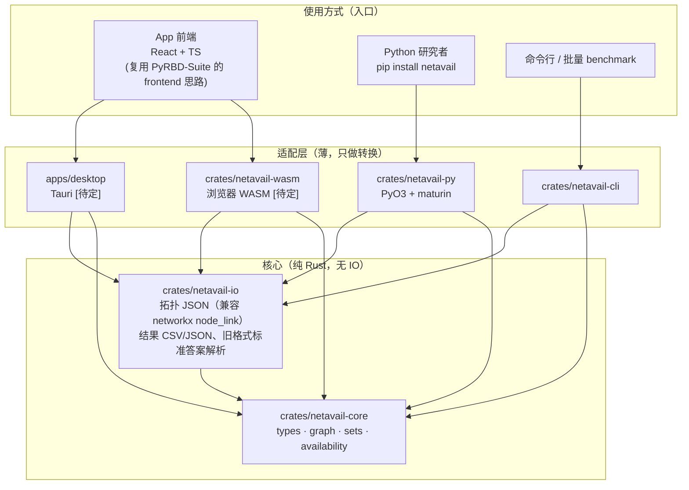
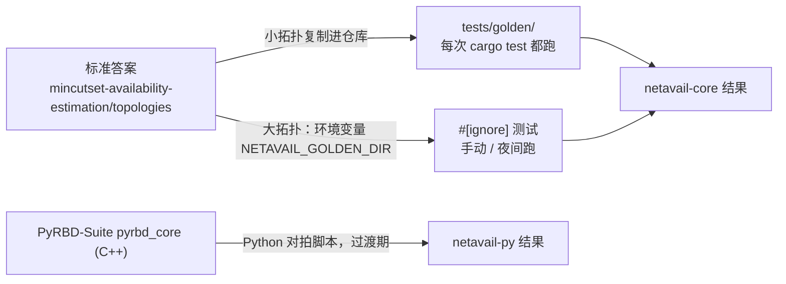

# netavail 架构（草案，待确认）

状态：提案。确认之前不写实现代码。标记为 **[待定]** 的地方需要项目负责人拍板。

## 1. 目标与约束

- 目标：用 Rust 重写 PyRBD-Suite 的计算核心，以此为后端，之后做一个方便使用、速度快的 app（桌面或 Web）。
- 算法整体思路不变。允许为了得到一致结果所必需的小改动，比如显式规定排序顺序。
- 结果一致性的定义：
  - 路集、割集：每个集合内部排序，集合列表再按（长度、字典序）排序，之后完全相等。
  - 可用度：与标准答案的绝对误差 ≤ 1e-12（暂定，第一轮对拍后再调）。
  - 中间表示（布尔表达式、SDP 项的顺序）不要求逐字一致。
- 不考虑论文复现。每篇论文都有导师仓库（shakthij98/PyRBD_plusplus、PyRBD3、Fast-MCS）可以复现。

## 2. 总体结构

一个 Cargo workspace：一个仓库里放多个 crate（Rust 的包），共用一套依赖版本和构建命令，`cargo build` / `cargo test` 一次跑全部。作用类似一个 monorepo。



依赖方向只能向下：`core` 不依赖任何其它 crate，也不做文件 IO，所以同一份算法既能编译成 Python 扩展，也能编译成 WASM 或桌面 app。

### 目录规划

```
netavail/
├── Cargo.toml                 # workspace 定义 + 统一依赖版本
├── crates/
│   ├── netavail-core/         # 算法本体
│   │   ├── src/
│   │   │   ├── types.rs       # NodeId, Lit, Set, ProbabilityMap
│   │   │   ├── graph.rs       # 邻接表、to_link_graph（链路→节点变换）
│   │   │   ├── sets/          # minimalpaths, cutsets_{cnf_tree,shannon,multiplication,combination,combination_matrix}, absorb
│   │   │   └── availability/  # mcs, pathset, sdp
│   │   └── benches/           # criterion 性能测试
│   ├── netavail-io/           # 拓扑与结果的读写
│   ├── netavail-py/           # Python 绑定（PyO3）+ pyproject.toml
│   └── netavail-cli/          # 命令行：compute / bench / golden-check
├── apps/desktop/              # [待定] Tauri app
├── tests/golden/              # 小拓扑的标准答案（随仓库提交）
├── tools/                     # 一次性 Python 脚本（pickle→JSON 等）
└── docs/
```

## 3. 核心类型

| 现在（C++） | netavail（Rust） | 说明 |
|---|---|---|
| `int`，正负号表示可用/不可用，内部 1 起始，绑定层 +1 偏移 | `Lit(u32)`，编码为 `node << 1 \| is_down` | 4 字节，与 int 性能一致；节点 0 可正常使用，不再需要 +1 偏移 |
| `NodeID = int` | `NodeId = u32` | 内外统一 0 起始 |
| `std::vector<int>` | `Vec<Lit>` / `Vec<NodeId>` | |
| `ProbabilityMap`（pos/neg 两个数组） | 同结构，按 `Lit` 下标取值 | |
| OpenMP `parallel for` | rayon `par_iter`，feature `parallel` | WASM 构建时关掉 feature 即为串行 |

`Lit` 的排序必须手写，复刻 C++ 里有符号整数（1 起始）的顺序：先排不可用的节点，节点号从大到小；再排可用的节点，节点号从小到大。等价于排序键 `is_down ? -(node+1) : (node+1)`。这一点要有单独的测试锁住，因为 SDP 的分解顺序依赖它。

C++ 的 `std::sort` 对等价元素不保证顺序（`sdp.cpp` 的 `eliminateSDPSet` 只按 `isComplementary` 比较），Rust 改用稳定排序。这是允许的小改动，依据是第 1 节的容差定义。

## 4. Python 入口

- 用 maturin 打 wheel 并发布到 PyPI。研究者只需 `pip install netavail`，不再需要 conda、gcc 11、CMake。安装比现在简单。
- 发布 abi3 wheel 时，一个 wheel 覆盖 Python 3.9+，在 Linux、macOS（Intel + Apple Silicon）、Windows 上用 CI 预编译。
- Python API 尽量保留现有 `pyrbd_suite` 的函数名（`minimalpaths`、`minimalcuts`、`evaluate_availability`）。
- networkx 作为可选依赖：Python 侧写一个薄包装，接受 `nx.Graph` 并转成边列表后传给 Rust。Rust 不认识 networkx 对象。

## 5. 测试策略



1. 标准答案对拍：读取旧 CSV，比较规范化后的集合与可用度。
2. 单元测试：`Lit` 排序、吸收、ProbabilityMap 等小函数。
3. 过渡期在 Python 里现场对拍：同一输入同时调用 `pyrbd_core_cpp` 和 `netavail`，比较输出。全部算法移植完成后删除。
4. CI：Linux、macOS、Windows 都跑 `cargo fmt --check`、`clippy`、`test`。

## 6. 开发阶段

| 阶段 | 内容 | 完成标准 |
|---|---|---|
| 0 | 仓库、架构文档、交接文档 | 本文档确认 |
| 1 | workspace 骨架、CI、`types.rs`（含 `Lit` 排序测试）、导入小拓扑标准答案 | CI 全绿 |
| 2 | 移植 `minimalpaths` 和 `mcs` 可用度计算（以标准答案割集为输入） | 小拓扑全部对上 |
| 3 | `netavail-py` + 与 C++ 现场对拍 + criterion 性能对比 | 速度不慢于 C++ |
| 4 | 其余割集算法、pathset 可用度、SDP | 全部标准答案对上 |
| 5 | 确定 app 形态并实现 | [待定] |

## 7. 待定问题

1. **App 形态**：Tauri 桌面 app / 浏览器 WASM（零部署）/ 服务端（axum）。核心与形态无关，第 5 阶段前决定即可。
2. **链路故障**：PyRBD-Suite 有 `to_link_graph`（把链路当成节点）。首批移植范围里要不要包含？
3. **Python API 形状**：完全照搬 `pyrbd_suite`，还是借机整理？
4. **最低支持的 Python 版本**：建议 3.9+。

已确认的决定记录在 [decisions.md](decisions.md)。许可证已定为 MIT（D13）。
